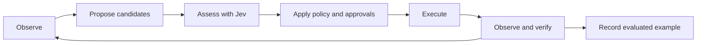

# Plan for browser decisions and learning with Jev

Status: implementation started, 2026-10-05. The first milestone implements
the Phase 0 classification benchmark and gate repairs, plus initial bounded
page context. Phases 1–5 remain pending, including the full evidence/trace
contract, shared decision tools, execution binding, outcome verification,
candidate selection, and validated memory. It builds on
[the browser and CLI model plan](plan-browser-and-cli-models.md) and preserves
the browser and purchase changes already in the working tree.

Goal: the browser agent can use Jev to choose useful actions, recognize when
it lacks evidence, and verify what happened. Evaluated runs then improve the
examples and decision criteria available to future runs. Code continues to
own execution, limits, and approvals.

The first deliverable is a shared action assessment and outcome verification
contract, with enough tracing to measure it. Persistent learning comes after
we can distinguish a correct decision from a successful tool call.

## First milestone built

- Added 20 labelled synthetic policy cases. The initial regression run passed
  4/20; the corrected policy passes 20/20. Both use scripted decisions, so this
  comparison measures policy composition rather than Jev intelligence.
- Purchase labels on links and activation through Enter/Space now use the
  same purchase classification. GET forms do not bypass destructive-action
  approval; Enter in a field considers its default submit button.
- Generic forms and links, ordinary buttons, field changes, checkboxes and
  selections now receive semantic assessment. Familiar labels such as “Next”
  and “Add to cart” no longer grant an unconditional local classification.
- Missing decision results refuse uncertain actions. A known purchase signal
  survives another unknown answer. Unknown browser tools default to refusal.
  Purchase dialogs require user handoff because the paused page cannot be
  checked by the purchase gate.
- Browser inspection adds up to 2,000 characters of nearby text, marks
  truncation, and excludes field values and scripts. Decision URLs omit
  credentials, query strings and fragments; card-number redaction also runs
  before the model call.
- Added browser fixtures that record the actual effects of autosave fields,
  GET actions, purchase links and keyboard activation. Tests check that denied
  actions never reach the fixture endpoint.
- Added `mix tiny_axe.browser_eval`: replay by default, optional real-decider
  classification, a call budget, and JSON evidence records. It does not
  execute browser actions or load real browsing sessions.

Results are in [the original regression record](../eval/results/20261005-browser-policy-before.json),
[the corrected replay](../eval/results/20261005-browser-policy-replay.json), and
[the synthetic Jev run](../eval/results/20261005-browser-policy-jev.json).
The benchmark is an initial development set, not a held-out evaluation of
complete browser tasks. Full driver evaluation and threshold calibration are
still required. Runtime task journals do not yet have the benchmark's detailed
decision traces, and thresholds remain provisional.

## Baseline behavior and gaps

| Responsibility | Current behavior | Needed change |
|---|---|---|
| Choose the next action | The agent chooses independently | Bounded candidate selection with Jev |
| Classify an action | Rules handle familiar actions; Jev handles unfamiliar buttons | Equivalent actions share assessment, with richer evidence |
| Check a purchase | Decider judges buying intent, item match, and optional card purpose | Preserve these checks and trace their evidence and results |
| Handle uncertainty | Missing button judgments become ordinary outward approval | Explicit abstention; uncertainty cannot weaken a stronger restriction |
| Verify completion | The agent's successful response is delivered directly | Check claimed outcomes against fresh observations |
| Learn from runs | Tool journals retain short execution records | Versioned decision traces and validated examples |

Relevant implementation:
[BrowserPolicy](../lib/tiny_axe/tools/browser_policy.ex),
[Gate](../lib/tiny_axe/tools/gate.ex),
[Agent](../lib/tiny_axe/agent.ex),
[Purchases](../lib/tiny_axe/purchases.ex), and
[Tools.Journal](../lib/tiny_axe/tools/journal.ex).

Before the first milestone, BrowserPolicy sent unfamiliar-button judgments only the page URL,
button label, and element tag/role. It omits the user's objective, nearby
text, recent outcomes, and the stage of the task. The earlier real-Jev
experiment recorded in the browser plan misclassified “Add to cart” as a
possible purchase; a label exception addressed that case.

In-memory probes of that classifier also established:

- A “Buy now” link with a short URL is classified as read without consulting
  Jev, because link handling precedes label checks.
- A GET form labelled “Delete account” is classified as read.
- Enter on a “Buy now” button outside a form is classified as local.
- `spends = 0.99` together with an unknown `sends` result becomes outward,
  bypassing the purchase-specific path.

These are classifier results using synthetic metadata and scripted answers,
not observed purchases or a measured real-Jev accuracy rate. Existing browser
tests mostly script the decider; the general evaluation tasks do not provide
a browser decision benchmark.

## Decision ownership

| Component | Owns |
|---|---|
| Browser agent | Task decomposition, candidate proposals, recovery, user-facing explanation |
| Browser sidecar | Observed page state, current targets, execution, fresh outcome evidence |
| Jev through Decider | Narrow semantic judgments over supplied evidence |
| Gate | Mandatory assessment, policy composition, approvals, execution limits |
| Evaluator | Independent outcome labels and comparisons between versions |
| Example store | Reviewed, versioned lessons retrieved for relevant tasks |

All three drivers use the same contract. A driver instruction alone cannot
enforce mandatory assessment. The gate must apply it even when an agent calls
an existing browser action directly.

Decision quality and execution authority remain separate: Jev recommending
an action does not approve it. Existing purchase checks, typed confirmation,
credential handling, and user denials remain authoritative. A local decider
must be evaluated separately; Jev thresholds cannot automatically be assumed
to work for another backend.

## The browser decision loop

### Build evidence in the harness

Create a bounded browser observation containing:

- Task ID, user objective, user constraints, and the current subgoal.
- Browser session, tab/frame identity, URL, observation ID, and capture time.
- Relevant visible text and controls, with actual element references.
- Target label, role, link destination, form metadata, and nearby context.
- Recent actions, their observed results, and unresolved outcomes.
- Candidate tool arguments and expected effects, explicitly labelled as
  agent proposals rather than observed facts.

The task's user instructions come from the harness's conversation state.
Agents cannot replace them with a more permissive objective. Page content,
tool output, retrieved examples, and agent predictions retain separate
provenance. Redact sensitive fields and URLs before any decision call or
trace write. Apply explicit text and candidate budgets, and report truncation
so missing evidence can trigger another observation.

Jev takes textual structured state; screenshots can assist a capable browser
driver but cannot be sent directly as Jev evidence. See TypeSafe's
[state documentation](https://docs.typesafe.ai/concepts/state).

### Provide three bounded decision operations

Proposed gate-owned tools are `browser_assess`, `browser_choose`, and
`browser_verify`. They share an internal service; they are not downstream MCP
tools, and their calls cannot recursively pass through browser assessment.

| Operation | Input supplied by the agent | Harness behavior | Result |
|---|---|---|---|
| Assess | Proposed tool and arguments, observation ID, expected effect | Resolve fresh target evidence and apply fixed questions | Disposition, reason codes, evidence references, next permitted step |
| Choose | Bounded candidates, observation ID, current subgoal | Validate candidates and ask Jev to select among them | Candidate ID, need more evidence, handoff, or none |
| Verify | Action/decision ID and claimed outcome | Obtain fresh observations and evaluate the expected effect | Succeeded, failed, or unresolved, with evidence |

The harness owns questions, criteria, thresholds, and user constraints. An
agent cannot submit arbitrary wording to turn a required check into an easy
question. The agent may ask for advice; direct execution still receives the
same required assessment. Pure reads can use deterministic checks without a
Jev round trip when their semantics are established.

A decision record includes the resolved backend/model, question and policy
versions, input evidence reference, individual answers, final disposition,
latency, and usage when available. Agent-visible responses expose enough
evidence and reason codes to support recovery, without requesting or logging
private reasoning. Example codes include `stale_target`,
`insufficient_evidence`, `constraint_mismatch`, `needs_purchase_confirmation`,
and `outcome_unresolved`.

### Ask atomic questions and combine them in code

Use separate questions for whether an action advances the subgoal, commits
payment now, publishes content, deletes stored data, or has insufficient
evidence. Define distinctions explicitly: adding an item to a cart differs
from placing its order; filling a draft differs from publishing it.

Use Choice for selecting among candidates, with “none” and “need more
evidence” options. The best of several bad candidates must not be treated as
acceptable. Use independent suitability judgments alongside the selection.
Batch independent questions about the same state; gather new evidence before
asking questions that depend on an earlier result.

Preserve optional Noul criteria in the Jev adapter and validate decoded
answers: valid probabilities, known choices, and complete required fields.
Retain returned model identity and usage without breaking existing Decider
callers. TypeSafe supports these request/response fields in its
[API reference](https://docs.typesafe.ai/api).

Compose policy monotonically: once an action needs purchase handling, an
unavailable unrelated answer cannot reduce it to ordinary approval. Missing
or ambiguous evidence should lead to another observation, handoff, or refusal.
Calibrate thresholds by backend and question version using held-out browser
data. TypeSafe's [confidence guidance](https://docs.typesafe.ai/concepts/confidence)
also makes thresholds dependent on the application and consequences.

### Bind assessment to execution

Bind each assessment to the task, browser session, tab/frame, target,
normalized arguments, and relevant observed state. The decision ID references
a gate-owned record; it is not a transferable authorization token.

Invalidate assessments after relevant navigation, target changes, argument
changes, or expiry. Recheck after waiting for user approval. Serialize the
final target validation and dispatch within the browser sidecar, and compare
the relevant action signature there. Treat this as protection against stale
state, not a guarantee that a website cannot change during execution.

Scope revision checks to relevant state so unrelated animations do not cause
endless reassessment. Isolate or explicitly lease browser tabs per task to
prevent concurrent agents from changing each other's active page. Bound
reobservation and retry loops. Cache only within valid observation scope.

For actions that may have submitted externally, timeouts and lost responses
produce an unresolved outcome. Gather evidence or hand off before any retry;
never repeat a purchase or submission merely because verification failed.

### Verify effects and completion

Capture expected effects before executing. Afterwards, use deterministic
checks where possible and Jev for semantic comparisons. Examples:

- Cart: the requested product, variant, and quantity are present.
- Search: returned results address the requested query or constraints.
- Message: the submitted content and recipient match, with confirmation.
- Purchase: receipt evidence supports the order; an uncertain receipt remains
  unresolved even if a click returned successfully.

Introduce a shared completion step in Agent before delivering a claimed
success. Compare claims with the task's verified outcomes. A bounded recovery
can collect missing evidence; otherwise report what is confirmed and what
remains unresolved. Keep observation failure distinct from action failure.

## Learning from evaluated runs

Start with a small curated set of examples illustrating how to use the
decision tools, including failures and abstentions. Give every driver the
same short workflow instructions and machine-readable feedback. Successful
repair of an invalid reference must be distinguished from a user denial,
which does not authorize another way of attempting the same action.

Persist a lesson only with this structure:

> Objective and constraints → observed evidence → candidate actions → Jev
> answers → policy disposition → executed action → verified result → correction.

Within a task, keep a compact record of failed attempts and unresolved
effects. Across tasks, retrieve a few examples relevant to the current
workflow and observation. Never reuse an old element reference or decision ID.

Promotion requires an independent fixture assertion or human review. User
approval, tool success, Jev agreement, and an agent's self-report are not
sufficient labels. An uncertain real-world outcome is excluded from the
validated example set until resolved. Page text cannot write instructions
into that set.

Version examples with their evidence schema and question/policy versions.
Support inspection, deletion, expiry, disabling retrieval, and rollback.
Start with synthetic fixture examples; require an explicit persistence
setting before retaining reusable real-session content. Store redacted
evidence separately from short routine logs with defined retention and access
permissions. Learned examples cannot alter policy, thresholds, or approvals.

Model fine-tuning and automatic policy rewriting are outside the initial
build. First establish that example retrieval improves held-out outcomes.

## Build phases and acceptance criteria

Each phase is a reviewable change with its own tests. The first useful release
ends after Phase 3; later phases depend on its measurements.

| Phase | Work | Acceptance criteria |
|---|---|---|
| 0 — Establish the baseline | Add labelled policy cases and browser tasks; record current results; fix demonstrated classification gaps | Purchase links, destructive GET forms, keyboard activation, mixed unknown answers, and unfamiliar actions exercise the intended gate paths |
| 1 — Evidence and traces | Add bounded observations, task context, versioned decision records, Jev metadata support, and redaction | Captured records explain the input, judgment, disposition, and result; evidence limits and malformed answers are tested |
| 2 — Shared assessment | Introduce the internal service and assess tool; enforce it on direct actions; bind and revalidate execution | All drivers get equivalent mandatory checks; stale or cross-task decisions cannot execute; missing answers cannot weaken restrictions |
| 3 — Outcome verification | Add fresh outcome observations, unresolved-effect handling, and shared completion checks | Failed or uncertain actions cannot produce an unsupported success claim; retries cannot duplicate an unresolved submission |
| 4 — Candidate selection | Add choose tool and concise driver examples; retrieve more evidence when candidates are unsuitable | Held-out completion or recovery improves without increasing dangerous misses, within the agreed call and latency budget |
| 5 — Validated memory | Add curated examples, retrieval, promotion rules, retention, and rollback | Retrieval improves held-out outcomes compared with the same system without memory; unvalidated traces never become trusted lessons |

In Phase 0, explicitly cover auto-saving fields, checkbox/select handlers,
dialogs, and both Enter and Space activation. DOM shape, a GET method, or a
familiar label alone cannot establish the absence of a side effect.

## Expected code boundaries

Module names below are proposed. Keep mandatory policy behavior in a single
path instead of copying it into the CLI drivers.

| Area | Planned responsibility |
|---|---|
| `priv/browser/server.mjs` and `TinyAxe.Browser` | Observations, target signatures, task/tab isolation, final validation and outcome evidence |
| `TinyAxe.Browser.Decisions` | Shared assessment, candidate selection, uncertainty handling, verification |
| `TinyAxe.Browser.Evidence` | Bounded normalized state, provenance, redaction and references |
| `TinyAxe.Tools.Gate` and `BrowserPolicy` | Tool exposure, required checks, policy composition, approvals and binding |
| `TinyAxe.Decider.Jev` and `Decider` | Criteria support, validated answers, compatible response metadata |
| `TinyAxe.Agent` and its drivers | Shared decision instructions, completion checks and recovery feedback |
| `TinyAxe.Browser.Examples` | Curated lesson storage, retrieval and version management |
| `Tools.Journal` and a decision trace store | Linked records with separate retention for detailed evidence |
| Browser evaluation task and fixtures | Real-decider benchmarks and independent browser outcome assertions |
| TUI tools and overlays | Short reasons, uncertainty and recovery status; existing approval flows |

## Evaluation design

Use the existing fixture server to record actual effects, expanding it into
several independent layouts and workflows. Add a dedicated browser evaluation
entry point rather than assuming the existing general pipeline evaluator can
verify browser tasks.

Run two layers:

- **Decision evaluation:** fixed labelled observations, actual Jev calls,
  per-question errors and uncertainty. Include cases where the correct result
  is to gather evidence. Scripted tests verify plumbing separately.
- **Agent evaluation:** full tasks through real browser drivers, with fixture
  assertions on server-side effects, final state, and submitted content.

Compare the original baseline, the corrected gate baseline, richer assessment,
assessment plus verification and selection, then example retrieval. Preserve
both baselines so classifier repairs are not credited to learning. Hold the
driver model and task distribution fixed within each comparison; report each
driver and decider backend separately.

Separate development and holdout sets by site/layout and workflow family.
Include paraphrases, ambiguous buttons, product variants, follow-up spending
limits, stale references, page instructions that conflict with the user,
Jev outages, malformed results, concurrent tasks, and lost submit responses.
Repeat runs and report counts and uncertainty, not a single favorable pass.

| Metric | Independent measurement |
|---|---|
| Task completion | Fixture state satisfies every requested constraint |
| Dangerous misses | Purchase, destructive or outward effects execute without their required path |
| False completion | Agent reports success unsupported by actual state |
| Approval burden | Unnecessary prompts on labelled safe cases |
| Useful abstention | Missing evidence leads to appropriate observation or handoff |
| Recovery | Failures repaired without repeated invalid calls or duplicate effects |
| Efficiency | Calls, input/output usage, active execution time and p50/p95 decision latency |
| Calibration | Observed correctness across probability bands, per question and backend |
| Learning gain | Difference with retrieval enabled on untouched holdout tasks |

Set task-success, latency, and call-budget targets after Phase 0 establishes
the baseline, before tuning. Required gate regressions must all pass. Any
observed unauthorized purchase or destructive action blocks rollout; zero
events in a finite suite is not a general safety guarantee. Record resolved
model versions and rerun the benchmark when aliases or decision criteria
change. Cap real-model evaluation requests and report budget exhaustion.

## Rollout and completion

Start new semantic judgments in shadow mode on fixture runs: collect decisions
without granting extra execution authority. Enforce the deterministic fixes
independently. Enable assessment, verification, selection, and retrieval in
that order as their acceptance criteria pass.

Use separate switches for advisory selection and example retrieval. Turning
them off preserves mandatory assessment and the corrected policy. A Jev
outage should take the defined uncertainty path; it must not silently switch
to a differently calibrated backend. Keep evaluation traces sufficient to
reproduce regressions and revert question/example versions.

The build is complete when every browser driver can use the same decision
interface, mandatory checks survive direct tool calls and stale state,
completion claims have evidence, and learning shows a measured improvement
on held-out workflows. Live purchases remain subject to the existing
purchase controls; fixture evaluation does not authorize transactions.
